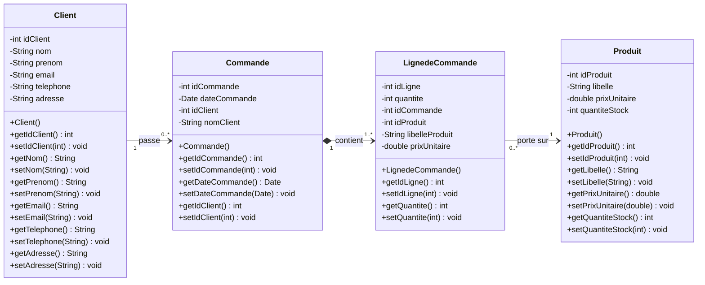
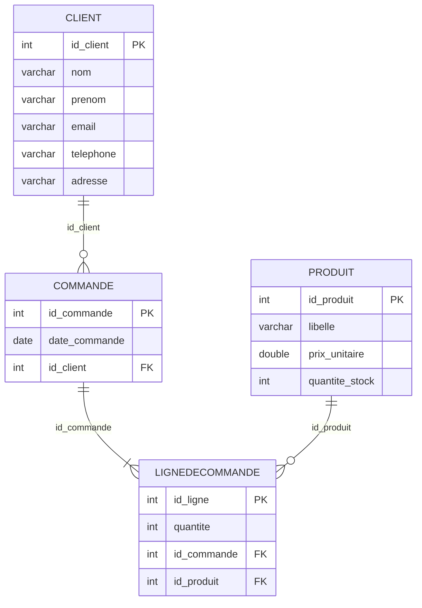
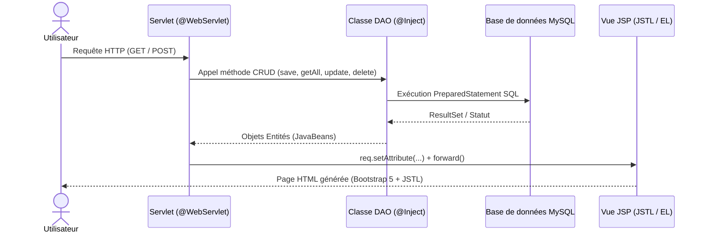
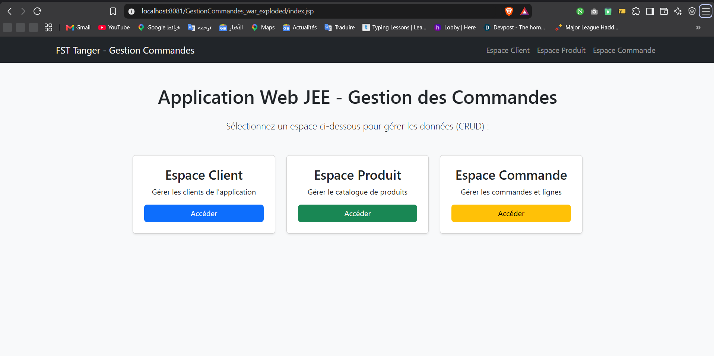
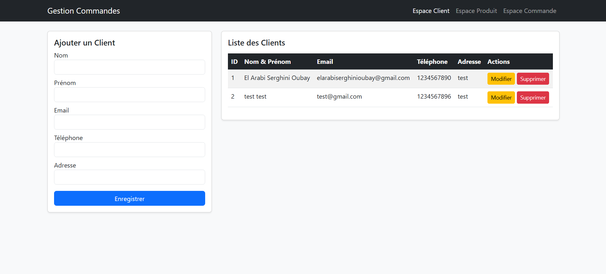
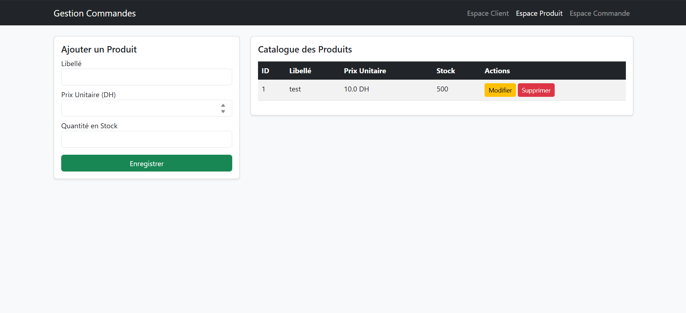
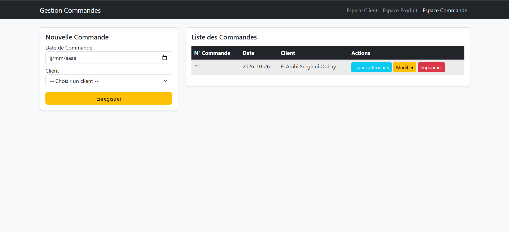
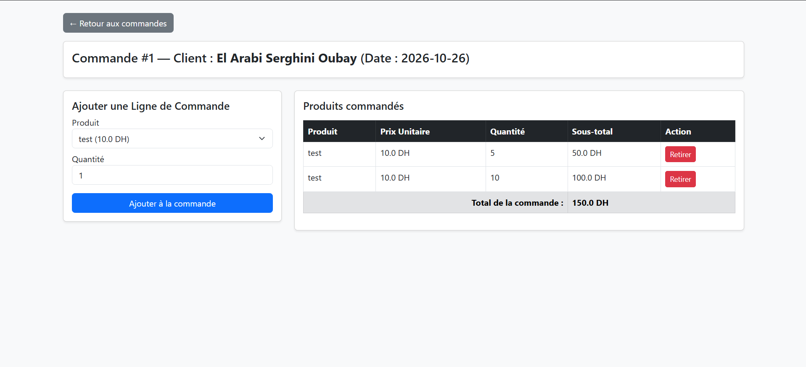

# Application Web JEE — Gestion des Commandes (Architecture MVC & DAO)


---

## Informations Académiques

* **Établissement :** Université Abdelmalek Essaadi — Faculté des Sciences et Techniques de Tanger (FSTT)
* **Département :** Génie Informatique
* **Filière :** Cycle Ingénieur — Logiciels et Systèmes Intelligents (LSI)
* **Module :** Architectures Distribuées & JEE
* **Encadré par :** Pr. Lotfi ELAACHAK
* **Réalisé par :** El Arabi Serghini Oubay

---

## Table des Matières

1. [Objectif de l'Atelier](#-1-objectif-de-latelier)
2. [Outils et Technologies Utilisés](#-2-outils-et-technologies-utilisés)
3. [Étape 1 : Conception UML (Diagramme de Classes)](#-3-étape-1--conception-uml-diagramme-de-classes)
4. [Étape 2 : Schéma de Base de Données Relationnel (MySQL)](#-4-étape-2--schéma-de-base-de-données-relationnel-mysql)
5. [Étape 3 : Configuration Maven et Injection de Dépendances (CDI)](#-5-étape-3--configuration-maven-et-injection-de-dépendances-cdi)
6. [Étape 4 : Architecture du Projet et Couche Persistance (DAO)](#-6-étape-4--architecture-du-projet-et-couche-persistance-dao)
7. [Étape 5 : Couche Contrôleur et Présentation (Servlets, JSP & JSTL)](#-7-étape-5--couche-contrôleur-et-présentation-servlets-jsp--jstl)
8. [Démonstration et Captures d'Écran](#-8-démonstration-et-captures-décran)
9. [Installation et Exécution du Projet](#-9-installation-et-exécution-du-projet)

---

## 1. Objectif de l'Atelier

L'objectif principal de cet atelier est de maîtriser les standards fondamentaux de la plateforme **JEE (Java Enterprise Edition)** — à savoir les **Servlets**, les pages **JSP (JavaServer Pages)** couplées aux expressions **JSTL (JSP Standard Tag Library)**, les **JavaBeans**, ainsi que l'injection de dépendances **CDI (`@Inject`, `@ApplicationScoped`)** — à travers la mise en place d'une application web complète de gestion des commandes clients.

L'application respecte rigoureusement :
* Le patron de conception **MVC (Modèle - Vue - Contrôleur)** basé sur les standards JEE natifs.
* Le patron **DAO (Data Access Object)** pour isoler la logique d'accès aux données (JDBC / MySQL) de la logique métier et de présentation.

---

## 2. Outils et Technologies Utilisés

| Catégorie | Technologie / Outil | Rôle dans le projet |
| :--- | :--- | :--- |
| **IDE** | IntelliJ IDEA Ultimate | Développement, gestion Maven et déploiement Tomcat |
| **Gestionnaire de Build** | Apache Maven | Gestion des dépendances (`pom.xml`) et packaging `.war` |
| **Serveur d'Application** | Apache Tomcat 9.0 | Conteneur web de Servlets et moteur JSP |
| **SGBD** | MySQL (via XAMPP) | Stockage relationnel des clients, produits et commandes |
| **Couche Persistance** | JDBC (`mysql-connector-j`) | Connexion et requêtes SQL préparées (`PreparedStatement`) |
| **Conteneur CDI** | JBoss Weld (`weld-servlet-shaded`) | Support des annotations `@Inject` et `@ApplicationScoped` |
| **Couche Vue** | JSP, JSTL 1.2, EL & Bootstrap 5 | Rendu dynamique côté serveur et interface responsive |

---

## 3. Étape 1 : Conception UML (Diagramme de Classes)

Le système de gestion des commandes s'articule autour de quatre classes entités principales :
1. **`Client`** : Identifie le client passant une ou plusieurs commandes (`idClient`, `nom`, `prenom`, `email`, `telephone`, `adresse`).
2. **`Commande`** : Représente une commande effectuée à une date donnée par un client unique (`idCommande`, `dateCommande`, `idClient`).
3. **`Produit`** : Représente un article commercialisé dans le catalogue (`idProduit`, `libelle`, `prixUnitaire`, `quantiteStock`).
4. **`LignedeCommande`** : Classe d'association matérialisant les articles contenus dans une commande avec la quantité commandée (`idLigne`, `quantite`, `idCommande`, `idProduit`).

### Diagramme de Classes UML



---

## 4. Étape 2 : Schéma de Base de Données Relationnel (MySQL)

Le diagramme de classes est traduit en un schéma relationnel MySQL nommé `gestion_commandes`. Les contraintes d'intégrité référentielle (`FOREIGN KEY ... ON DELETE CASCADE`) garantissent la cohérence des données lors des suppressions.

### Diagramme Entité-Association (ERD)



### Script d'Implémentation SQL (`schema.sql`)

```sql
CREATE DATABASE IF NOT EXISTS gestion_commandes;
USE gestion_commandes;

CREATE TABLE client (
    id_client INT AUTO_INCREMENT PRIMARY KEY,
    nom VARCHAR(100) NOT NULL,
    prenom VARCHAR(100) NOT NULL,
    email VARCHAR(150),
    telephone VARCHAR(20),
    adresse VARCHAR(255)
);

CREATE TABLE produit (
    id_produit INT AUTO_INCREMENT PRIMARY KEY,
    libelle VARCHAR(150) NOT NULL,
    prix_unitaire DOUBLE NOT NULL,
    quantite_stock INT NOT NULL
);

CREATE TABLE commande (
    id_commande INT AUTO_INCREMENT PRIMARY KEY,
    date_commande DATE NOT NULL,
    id_client INT NOT NULL,
    CONSTRAINT fk_commande_client FOREIGN KEY (id_client) 
        REFERENCES client(id_client) ON DELETE CASCADE
);

CREATE TABLE lignedecommande (
    id_ligne INT AUTO_INCREMENT PRIMARY KEY,
    quantite INT NOT NULL,
    id_commande INT NOT NULL,
    id_produit INT NOT NULL,
    CONSTRAINT fk_ligne_commande FOREIGN KEY (id_commande) 
        REFERENCES commande(id_commande) ON DELETE CASCADE,
    CONSTRAINT fk_ligne_produit FOREIGN KEY (id_produit) 
        REFERENCES produit(id_produit) ON DELETE CASCADE
);
```

---

## 5. Étape 3 : Configuration Maven et Injection de Dépendances (CDI)

Le projet web dynamique est géré par **Maven** via le fichier `pom.xml`. Afin de respecter les exigences de l'atelier (connecteur MySQL, expressions JSTL et annotations CDI `@Inject` et `@ApplicationScoped` sur un conteneur léger comme Apache Tomcat), les dépendances suivantes ont été intégrées :

```xml
<dependencies>
    <!-- API Servlet 4.0 & JSP 2.3 -->
    <dependency>
        <groupId>javax.servlet</groupId>
        <artifactId>javax.servlet-api</artifactId>
        <version>4.0.1</version>
        <scope>provided</scope>
    </dependency>
    <dependency>
        <groupId>javax.servlet.jsp</groupId>
        <artifactId>javax.servlet.jsp-api</artifactId>
        <version>2.3.3</version>
        <scope>provided</scope>
    </dependency>

    <!-- JSTL 1.2 pour les vues JSP -->
    <dependency>
        <groupId>javax.servlet</groupId>
        <artifactId>jstl</artifactId>
        <version>1.2</version>
    </dependency>

    <!-- Driver JDBC MySQL -->
    <dependency>
        <groupId>com.mysql</groupId>
        <artifactId>mysql-connector-j</artifactId>
        <version>8.0.33</version>
    </dependency>

    <!-- Conteneur CDI (JBoss Weld) pour @Inject et @ApplicationScoped -->
    <dependency>
        <groupId>org.jboss.weld.servlet</groupId>
        <artifactId>weld-servlet-shaded</artifactId>
        <version>3.1.9.Final</version>
    </dependency>
</dependencies>
```

L'activation du conteneur CDI sur Tomcat est assurée par :
1. Le fichier descripteur **`WEB-INF/beans.xml`** (`bean-discovery-mode="all"`).
2. L'écouteur **`org.jboss.weld.environment.servlet.Listener`** déclaré dans **`WEB-INF/web.xml`**.

---

## 6. Étape 4 : Architecture du Projet et Couche Persistance (DAO)

Le projet est structuré en packages distincts conformément aux spécifications de l'énoncé :

```text
GestionCommandes/
├── pom.xml
└── src/main/
    ├── java/ma/fstt/
    │   ├── entities/                  # JavaBeans (Modèle de données)
    │   │   ├── Client.java
    │   │   ├── Produit.java
    │   │   ├── Commande.java
    │   │   └── LignedeCommande.java
    │   ├── service/                   # Interfaces de la couche persistance
    │   │   └── BaseRepository.java
    │   ├── dao/                       # Implémentations DAO (@ApplicationScoped) & JDBC
    │   │   ├── ConnectionManager.java
    │   │   ├── ClientDao.java
    │   │   ├── ProduitDao.java
    │   │   ├── CommandeDao.java
    │   │   └── LignedeCommandeDao.java
    │   └── controller/                # Contrôleurs JEE (@WebServlet & @Inject)
    │       ├── ClientServlet.java
    │       ├── ProduitServlet.java
    │       └── CommandeServlet.java
    └── webapp/
        ├── index.jsp                  # Tableau de bord principal
        └── WEB-INF/
            ├── web.xml                # Configuration du Listener CDI Weld
            ├── beans.xml              # Activation de la découverte des beans CDI
            └── views/                 # Vues JSP protégées utilisant JSTL
                ├── clients.jsp
                ├── produits.jsp
                ├── commandes.jsp
                └── lignes-commande.jsp
```

### Points clés de la couche Persistance :
* **Contrat Générique (`ma.fstt.service.BaseRepository<T>`)** : Définit les 5 méthodes CRUD standards (`save`, `update`, `delete`, `getById`, `getAll`) implémentées par tous les DAO.
* **Singleton JDBC (`ma.fstt.dao.ConnectionManager`)** : Gère une instance unique de connexion vers `jdbc:mysql://localhost:3306/gestion_commandes`.
* **Beans DAO (`@ApplicationScoped`)** : Chaque classe DAO (`ClientDao`, `ProduitDao`, `CommandeDao`, `LignedeCommandeDao`) est annotée avec `@ApplicationScoped` afin que le conteneur CDI maintienne une instance partagée à l'échelle de l'application et l'injecte dans les Servlets via `@Inject`.

---

## 7. Étape 5 : Couche Contrôleur et Présentation (Servlets, JSP & JSTL)

### Flux MVC de l'Application



### Récapitulatif des Espaces Fonctionnels et Endpoints

| Espace | URL Servlet | Vue JSP associée | Fonctionnalités implémentées |
| :--- | :--- | :--- | :--- |
| **Accueil** | `/index.jsp` | `index.jsp` | Tableau de bord de navigation vers les 3 espaces |
| **Espace Client** | `/clients` | `WEB-INF/views/clients.jsp` | Ajout, consultation, modification et suppression de clients |
| **Espace Produit** | `/produits` | `WEB-INF/views/produits.jsp` | Gestion complète du catalogue (libellé, prix unitaire, stock) |
| **Espace Commande** | `/commandes` | `WEB-INF/views/commandes.jsp` | Création de commandes liées aux clients (jointure SQL), édition et suppression |
| **Détails Commande** | `/commandes?action=details` | `WEB-INF/views/lignes-commande.jsp` | Affectation de produits à une commande, suppression de lignes et calcul automatique du total via JSTL (`<c:forEach>`, `<c:set>`) |

---

## 8. Démonstration et Captures d'Écran

### 1. Tableau de Bord Principal (`index.jsp`)
Interface d'accueil permettant d'accéder rapidement aux trois espaces de l'application :


### 2. Espace Client (`/clients`)
Gestion CRUD complète des clients (formulaire d'ajout/modification et tableau récapitulatif) :


### 3. Espace Produit (`/produits`)
Gestion du catalogue des produits et des quantités en stock :


### 4. Espace Commande (`/commandes`)
Création et suivi des commandes associées aux clients enregistrés :


### 5. Gestion des Lignes de Commande (`/commandes?action=details`)
Ajout de produits dans une commande spécifique avec calcul dynamique des sous-totaux et du montant total :


---

## 9. Installation et Exécution du Projet

1. **Cloner le dépôt GitHub :**
   ```bash
   git clone https://github.com/VOTRE_USERNAME/GestionCommandes.git
   ```
2. **Configurer la base de données MySQL :**
    * Démarrer le service **MySQL** (via XAMPP ou MySQL Server sur le port `3306`).
    * Exécuter le script SQL fourni dans la section [Étape 2](#-4-étape-2--schéma-de-base-de-données-relationnel-mysql).
3. **Déployer sur Apache Tomcat :**
    * Ouvrir le projet dans **IntelliJ IDEA** ou **Eclipse**.
    * Laisser Maven télécharger les dépendances du fichier `pom.xml`.
    * Configurer un serveur **Apache Tomcat 9** et déployer l'artefact `GestionCommandes:war exploded`.
    * Accéder à l'application via : `http://localhost:8081/GestionCommandes_war_exploded/`